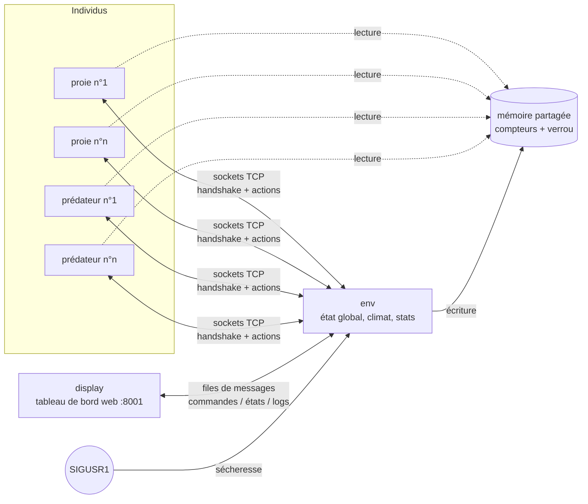

<sub>[English](README.md) · Français</sub>

# The Circle of Life 🦊🐑🌱

**Une simulation multiprocessus d'écosystème en Python : chaque animal est un processus du système.**
Prédateurs, proies et herbe interagissent par mémoire partagée, sockets, files de messages et signaux, et un tableau de bord web en direct permet d'observer et de piloter l'écosystème en temps réel.


<sub>Tableau de bord en direct pendant une sécheresse : l'herbe s'est effondrée et les proies manquent de nourriture.</sub>

Réalisé pour le cours de **Programmation Parallèle et Concurrente (PPC)** de l'INSA Lyon par **Anas Sfar** et **Farah Gattoufi**.

## Points clés

- **Un processus par individu** : chaque proie et chaque prédateur est un `multiprocessing.Process` distinct, créé et arrêté dynamiquement (naissances, morts, actions de l'utilisateur)
- **Quatre mécanismes d'IPC**, chacun utilisé là où il est pertinent : mémoire partagée, sockets TCP, files de messages et signaux POSIX
- **État partagé sans conflit d'accès** : les compteurs globaux sont en mémoire partagée, protégés par un verrou, et écrits uniquement par le processus d'environnement
- **Modèle probabiliste** : se nourrir, chasser et se reproduire réussissent avec des probabilités configurables, si bien que la dynamique des populations émerge au lieu d'être écrite à l'avance
- **Interface web en direct** sans aucune dépendance : un petit serveur HTTP diffuse les états et reçoit les commandes
- **Bibliothèque standard uniquement** : rien à installer

## Architecture



| Processus | Rôle |
|---|---|
| `env` | Détient l'état global : populations, herbe, climat, statistiques |
| `prey` | Une proie (1 processus = 1 individu) |
| `predator` | Un prédateur |
| `display` | Tableau de bord web et contrôles utilisateur |

### Comment les processus communiquent

| Mécanisme | Utilisé pour |
|---|---|
| **Mémoire partagée** (`multiprocessing.Value` + `Lock`) | Compteurs globaux (prédateurs, proies, herbe). Les individus lisent, seul `env` écrit |
| **Sockets** (TCP) | Chaque proie et chaque prédateur se connecte à `env` : handshake au démarrage, puis envoi de ses actions probabilistes (succès / échec) |
| **Files de messages** | `display → env` : commandes de l'utilisateur ; `env → display` : états périodiques (statistiques d'énergie, probabilités moyennes de nourriture et de reproduction) et logs |
| **Signaux** | Les sécheresses sont déclenchées par `SIGUSR1` et gérées uniquement par `env` |

## Modèle de simulation

### Énergie et états

- Chaque individu démarre avec une énergie aléatoire entre 30 et 60.
- L'énergie baisse à chaque tick (1 s) ; les proies en perdent deux fois plus vite que les prédateurs.
- Sous le seuil `H = 30`, un individu devient **actif** et cherche à se nourrir ; une fois nourri, il redevient **passif** (au-dessus de `H` pour les proies, au-dessus de `1,5 × H` pour les prédateurs, une petite hystérésis qui fait chasser les prédateurs un peu plus longtemps).
- Quand l'énergie passe sous zéro, le processus meurt, `env` est prévenu et les compteurs partagés sont mis à jour.

### Nourriture probabiliste

- Une proie active mange de l'herbe avec une probabilité de **80 %**.
- Un prédateur actif attrape une proie avec une probabilité de **60 %**, et ne peut attraper que des proies **actives**.

Cela évite une dynamique rigide et déterministe et laisse émerger des comportements. Les probabilités sont configurables dans `config.py`, et leurs moyennes mesurées s'affichent sur le tableau de bord.

### Reproduction probabiliste

Un individu peut se reproduire s'il est vivant et que son énergie dépasse `R = 60`, et même alors seulement avec une probabilité de **50 %**. Cela évite l'explosion des populations et rend la simulation plus stable dans le temps.

### Herbe et sécheresses

- L'herbe repousse à chaque tick.
- Une sécheresse (déclenchée par signal) divise l'herbe par deux et ralentit sa pousse à 10 unités par tick.

## Lancer la simulation

Nécessite Python 3.12+ sous Linux ou macOS (la simulation s'appuie sur les signaux POSIX).

```bash
python3 main.py
```

Ouvrir ensuite **http://127.0.0.1:8001**, ajouter quelques proies et prédateurs, puis déclencher une sécheresse pour voir comment l'écosystème réagit.

Tous les paramètres (seuils, coûts et gains d'énergie, probabilités, plafonds de population, ports) sont dans [`config.py`](config.py).

## Notions illustrées

- Multiprocessing en Python et gestion dynamique des processus
- Synchronisation et sections critiques
- Communication inter-processus avec quatre mécanismes différents
- Modélisation probabiliste et comportements émergents
- Arrêt propre et cohérence de l'état global

## Auteurs

- **Anas Sfar**
- **Farah Gattoufi**

## Licence

[MIT](LICENSE)
