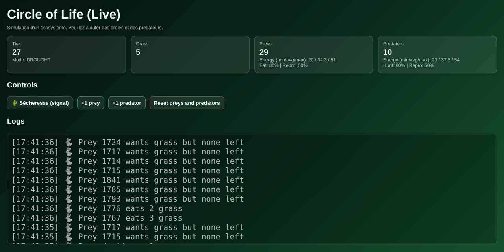
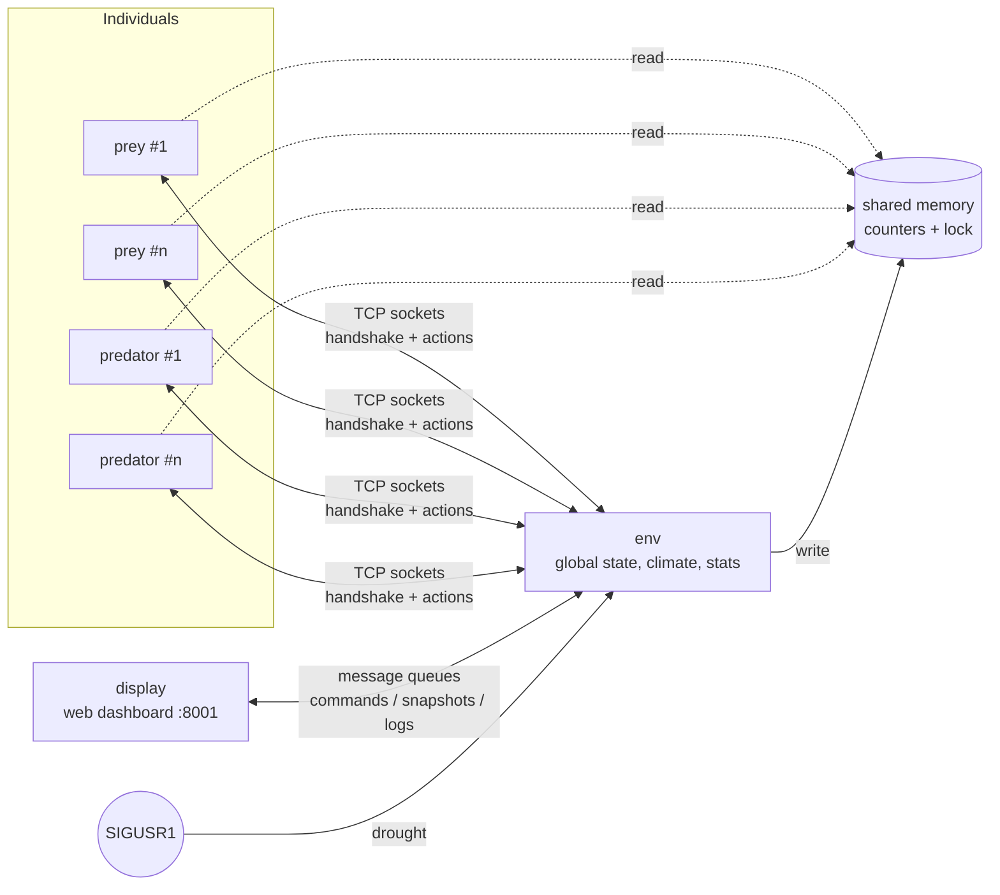

<sub>🇬🇧 English · [🇫🇷 Français](README.fr.md)</sub>

# The Circle of Life 🦊🐑🌱

**A multi-process ecosystem simulation in Python: every animal is its own OS process.**
Predators, prey and grass interact through shared memory, sockets, message queues and signals, and a live web dashboard lets you watch and steer the ecosystem in real time.



<sub>Live dashboard during a drought: grass has collapsed and prey are starving.</sub>

Built for the **Parallel and Concurrent Programming (PPC)** course at INSA Lyon by **Anas Sfar** and **Farah Gattoufi**.

## Highlights

- **One process per individual**: each prey and each predator is a separate `multiprocessing.Process`, spawned and terminated dynamically (births, deaths, user actions)
- **Four IPC mechanisms**, each used where it fits: shared memory, TCP sockets, message queues and POSIX signals
- **Race-free shared state**: global counters live in shared memory, protected by a lock, written only by the environment process
- **Probabilistic model**: feeding, hunting and reproduction succeed with configurable probabilities, so population dynamics emerge instead of being scripted
- **Live web UI** with zero dependencies: a small HTTP server streams snapshots and accepts commands
- **Standard library only**: no package to install

## Architecture



| Process | Role |
|---|---|
| `env` | Owns the global state: populations, grass, climate, statistics |
| `prey` | One prey (1 process = 1 individual) |
| `predator` | One predator |
| `display` | Web dashboard and user controls |

### How the processes talk

| Mechanism | Used for |
|---|---|
| **Shared memory** (`multiprocessing.Value` + `Lock`) | Global counters (predators, prey, grass). Individuals read, only `env` writes |
| **Sockets** (TCP) | Each prey and predator connects to `env`: start-up handshake, then its probabilistic actions (success / failure) |
| **Message queues** | `display → env` user commands; `env → display` periodic snapshots (energy stats, average feeding and reproduction probabilities) and logs |
| **Signals** | Droughts are raised with `SIGUSR1` and handled only by `env` |

## Simulation model

### Energy and states

- Each individual starts with a random energy between 30 and 60.
- Energy decreases at every tick (1 s); prey lose energy twice as fast as predators.
- Below the threshold `H = 30` an individual becomes **active** and tries to feed; once fed it goes back to **passive** (above `H` for prey, above `1.5 × H` for predators, a small hysteresis that keeps hunters going a bit longer).
- When energy drops below zero, the process dies, `env` is notified and the shared counters are updated.

### Probabilistic feeding

- An active prey eats grass with an **80%** probability.
- An active predator catches a prey with a **60%** probability, and can only catch **active** prey.

This avoids rigid, deterministic dynamics and lets behaviours emerge. Probabilities are configurable in `config.py`, and their measured averages are shown on the dashboard.

### Probabilistic reproduction

An individual can reproduce when it is alive and its energy is above `R = 60`, and even then only with a **50%** probability. This keeps populations from exploding and makes the simulation more stable over time.

### Grass and droughts

- Grass grows back at every tick.
- A drought (triggered by signal) halves the grass and slows its growth to 10 units per tick.

## Run it

Requires Python 3.12+ on Linux or macOS (the simulation relies on POSIX signals).

```bash
python3 main.py
```

Then open **http://127.0.0.1:8001**, add some prey and predators, and trigger a drought to see how the ecosystem reacts.

All parameters (thresholds, energy costs and gains, probabilities, population caps, ports) are in [`config.py`](config.py).

## Concepts illustrated

- Python multiprocessing and dynamic process management
- Synchronisation and critical sections
- Inter-process communication with four different mechanisms
- Probabilistic modelling and emergent behaviour
- Clean shutdown and consistency of the global state

## Authors

- **Anas Sfar**
- **Farah Gattoufi**

## License

[MIT](LICENSE)
